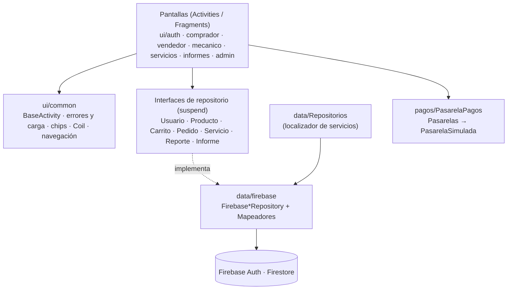
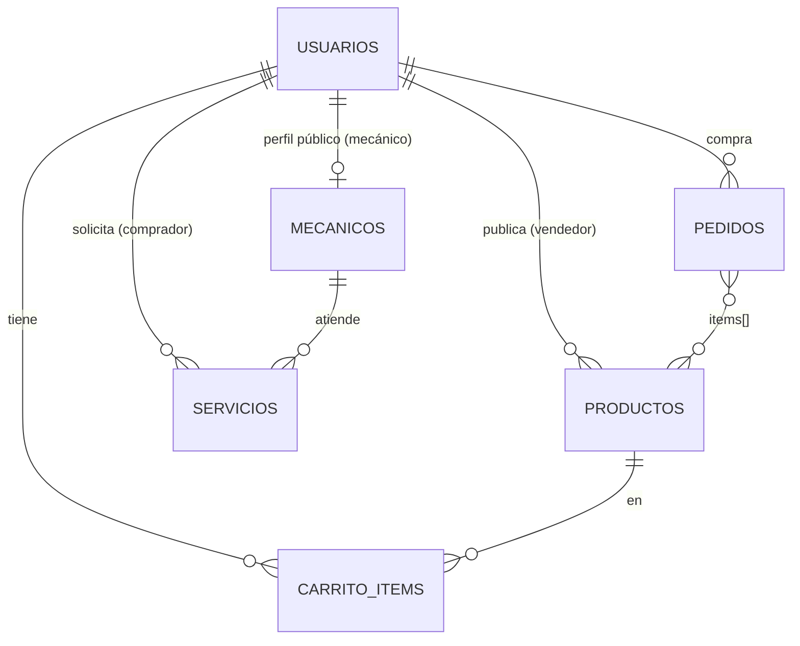
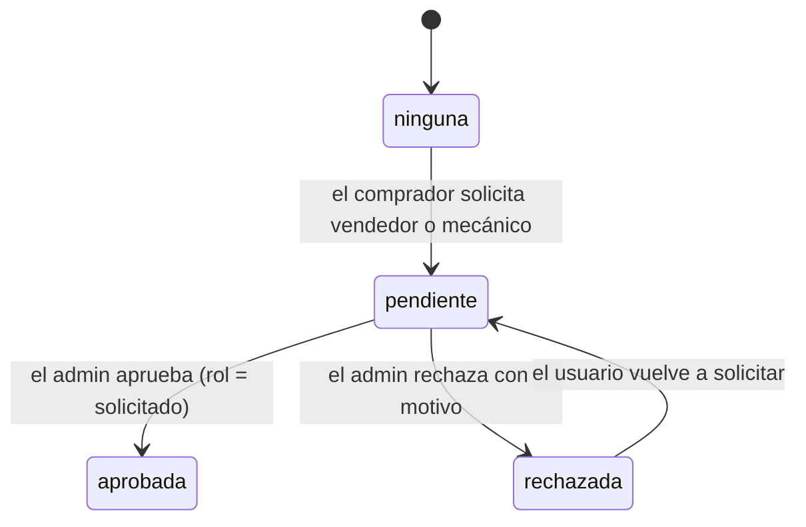
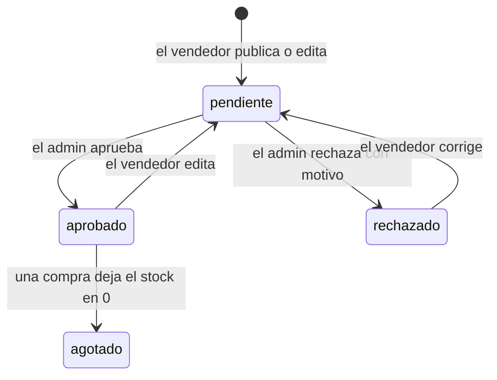
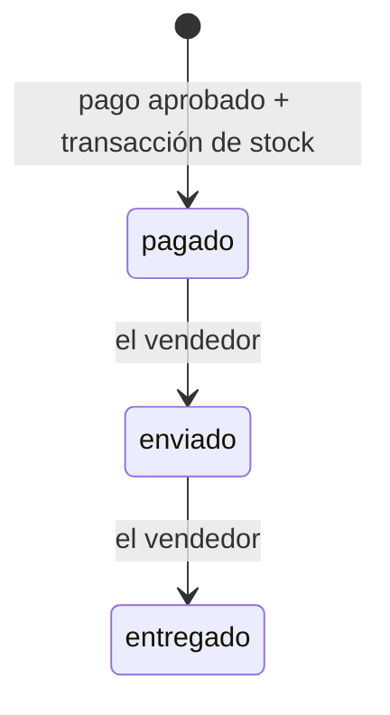
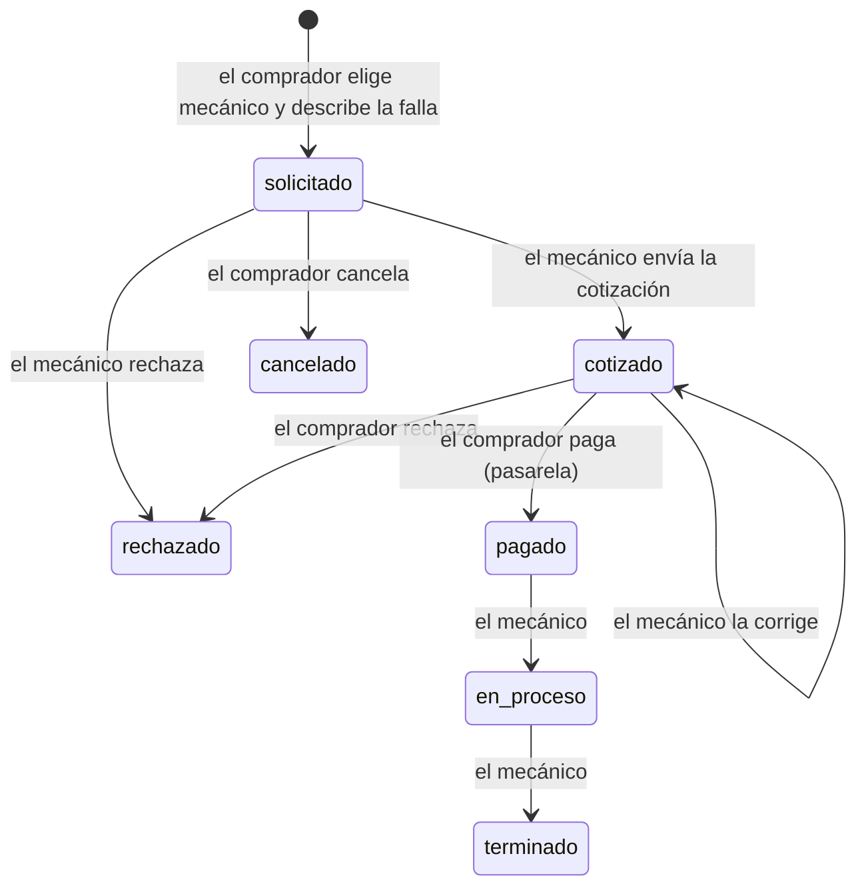

# MotoMarket — Documento técnico

**Proyecto:** MotoMarket, marketplace de repuestos, accesorios y servicio técnico para motos en Colombia
**Plataforma:** Android nativo (Kotlin + Views/XML) con Firebase
**Contexto:** Proyecto final del curso de Aplicaciones Móviles
**Repositorio:** https://github.com/BStivenRamirezM/MotoMarket

---

## 1. Objetivo y alcance

MotoMarket conecta a quienes necesitan repuestos o reparaciones para su moto con tiendas y talleres verificados. La aplicación permite:

- **Comprar** repuestos y accesorios con carrito persistente, entrega geolocalizada y pago en línea.
- **Vender** productos con fotos, sujetos a moderación del administrador.
- **Solicitar servicio técnico**: el comprador describe la falla, un mecánico aprobado envía una cotización detallada y el comprador la paga en la app.
- **Administrar** la plataforma: aprobar vendedores, mecánicos y productos; gestionar usuarios y roles; consultar métricas e informes.

Por ahora el pago se procesa con una **pasarela simulada**. La arquitectura queda lista para integrar Mercado Pago (ver §10).

## 2. Roles

| Rol | Qué puede hacer | Cómo se obtiene |
|---|---|---|
| **Comprador** | Comprar productos, solicitar y pagar servicios técnicos, ver su historial, solicitar ser vendedor o mecánico | Automático al registrarse |
| **Vendedor** | Publicar, editar y eliminar productos con fotos; gestionar pedidos recibidos; consultar sus informes | Solicitud aprobada por un administrador |
| **Mecánico** | Recibir solicitudes de servicio, cotizar con conceptos libres (cantidad × precio), rechazar solicitudes y avanzar el trabajo | Solicitud aprobada por un administrador |
| **Administrador** | Panel de métricas, gestión de usuarios y roles, aprobación de solicitudes y productos, reportes e informes globales | El primero se asigna en la consola de Firebase; los siguientes, desde la app por otro admin |

**Principio de seguridad:** nadie se asigna un rol a sí mismo. Toda cuenta nace como comprador, y solo un administrador cambia roles. Las reglas de Firestore lo garantizan en el servidor (§7).

## 3. Requisitos funcionales

### Autenticación y cuenta
| ID | Requisito |
|---|---|
| RF-01 | Registro con nombre, correo, teléfono y contraseña (mínimo 8 caracteres); la cuenta nace como comprador. |
| RF-02 | En el registro, el usuario puede pedir ser vendedor o mecánico indicando el nombre de su tienda o taller. |
| RF-03 | Inicio de sesión con correo y contraseña; las cuentas desactivadas o sin perfil no entran. |
| RF-04 | Reingreso con huella (BiometricPrompt) si hay una sesión válida en el dispositivo. |
| RF-05 | Recuperación de contraseña por correo. |
| RF-06 | Cierre de sesión en todos los roles, limpiando la navegación. |
| RF-07 | Desde su perfil, el comprador puede solicitar ser vendedor o mecánico y ver el estado o el motivo del rechazo. |

### Comprador
| ID | Requisito |
|---|---|
| RF-10 | Catálogo de productos aprobados con foto, búsqueda por texto y filtro por categoría. |
| RF-11 | Detalle del producto y agregar al carrito validando el stock. |
| RF-12 | Carrito persistente entre sesiones con eliminar, deshacer y vaciar. |
| RF-13 | Dirección de entrega por GPS (permiso en tiempo de ejecución + Geocoder) o escrita manualmente. |
| RF-14 | Pago con la pasarela configurada; si se aprueba, se crea la orden, se descuenta el stock en una transacción y se vacía el carrito. |
| RF-15 | Historial de órdenes con su estado de envío. |
| RF-16 | Solicitar servicio técnico eligiendo un mecánico aprobado y describiendo la moto y la falla. |
| RF-17 | Aceptar y pagar, o rechazar, la cotización de un servicio; cancelar la solicitud antes de la cotización. |

### Vendedor
| ID | Requisito |
|---|---|
| RF-20 | Crear, editar y eliminar productos con foto (cámara o galería), comprimida a ~200 KB (máx. 800 px) y guardada en Base64 dentro del documento del producto. |
| RF-21 | Todo producto nuevo o editado queda pendiente de aprobación. |
| RF-22 | Ver los pedidos que incluyen sus productos y avanzar su estado: por enviar → enviado → entregado. |
| RF-23 | Informes de sus ventas, sus productos más vendidos y el estado de sus pedidos, exportables a CSV. |

### Mecánico
| ID | Requisito |
|---|---|
| RF-30 | Ver los servicios técnicos que le asignaron. |
| RF-31 | Cotizar con conceptos libres (descripción, cantidad y precio unitario) y corregir mientras no esté pagado. |
| RF-32 | Rechazar una solicitud con un motivo. |
| RF-33 | Avanzar un servicio pagado: en proceso → terminado. |

### Administrador
| ID | Requisito |
|---|---|
| RF-40 | Panel con usuarios activos, productos publicados, ventas del mes (productos + servicios) y % de órdenes pagadas. |
| RF-41 | Aprobar o rechazar, con motivo, las solicitudes para ser vendedor o mecánico. |
| RF-42 | Buscar usuarios, activar o desactivar cuentas, cambiar roles y crear usuarios sin perder su sesión. |
| RF-43 | Aprobar o rechazar, con motivo, las publicaciones de productos. |
| RF-44 | Gráfico de ingresos de los últimos 6 meses. |
| RF-45 | Informes globales con filtros de tipo y período (ventas, más vendidos, estado de pedidos, servicios, usuarios), exportables a CSV. |
| RF-46 | Carga opcional de los productos de ejemplo de los mockups. |

## 4. Requisitos no funcionales

| Categoría | Cómo se cumple |
|---|---|
| Seguridad | Firebase Auth; reglas de Firestore por rol; ningún usuario se asigna un rol; credenciales fuera del código (`google-services.json` y `local.properties` no se versionan); sesión de la huella cifrada con EncryptedSharedPreferences. |
| Integridad | Compra con transacción de Firestore (valida y descuenta stock de forma atómica); el comprador no puede alterar el valor de una cotización. |
| Usabilidad | Diseño fiel a los mockups, textos en español, indicadores de carga y mensajes de error claros; validación de formularios. |
| Mantenibilidad | Arquitectura en capas con interfaces de repositorio, localizador de servicios y pasarela intercambiable; KDoc en clases y métodos. |
| Rendimiento | Imágenes comprimidas (~200 KB) y decodificadas en segundo plano con caché LRU en memoria; búsquedas con espera para no consultar en cada tecla; conteos con agregaciones del servidor. |
| Compatibilidad | Android 8.0 (API 26) a Android 17 (API 37), con edge-to-edge manejado en `BaseActivity`. |

## 5. Arquitectura



**Patrones utilizados**
- **Repository:** las pantallas dependen de interfaces (`ProductoRepository`, etc.), nunca de Firebase.
- **Service Locator** (`Repositorios.kt`): un único punto decide qué implementación se usa. Cambiar de backend no toca las pantallas.
- **Strategy** (`PasarelaPagos` + `Pasarelas.kt`): la pasarela de pagos es intercambiable (simulada hoy, Mercado Pago después).
- **Corrutinas:** todas las llamadas remotas son `suspend` con `await()` y se lanzan con `lifecycleScope` o `viewLifecycleOwner.lifecycleScope`.
- **Manejo centralizado de errores** (`intentar` / `conCarga`): muestran la carga, deshabilitan botones y traducen las excepciones de Firebase a mensajes en español.

## 6. Tecnologías

| Componente | Tecnología |
|---|---|
| Lenguaje | Kotlin 2.4 |
| UI | Views + XML, ViewBinding, Material Components 3 |
| Build | Android Gradle Plugin 9.5, Gradle 9.8.2, catálogo de versiones |
| Backend | Firebase BOM 35.2.0: Auth y Cloud Firestore (sin Storage); google-services 4.6.0 |
| Asincronía | kotlinx-coroutines-play-services |
| Imágenes | Coil 3; cámara con FileProvider + TakePicture; galería con PickVisualMedia; ExifInterface |
| Ubicación | Fused Location Provider + Geocoder |
| Seguridad local | AndroidX Biometric + Security Crypto |
| SDK | minSdk 26, compile/targetSdk 37 |

## 7. Seguridad

### 7.1 Reglas de Firestore (`firestore.rules`)

| Colección | Lectura | Escritura |
|---|---|---|
| `usuarios/{uid}` | El propio usuario o un admin | Crear: el propio usuario solo como `comprador` (con una solicitud opcional `pendiente`), o un admin. Actualizar: el propio usuario sin tocar `rol`, `activo` ni `calificacion`, y su solicitud solo puede pasar a `pendiente`; un admin, todo. |
| `mecanicos/{uid}` | Cualquier usuario autenticado | Solo admin |
| `productos/{id}` | Aprobados y agotados: autenticados; los demás: dueño o admin | Crear o editar: el vendedor dueño (queda `pendiente`) o un admin. Al comprar: solo descontar `stock` (y marcar `agotado` en 0). |
| `pedidos/{id}` | Comprador, vendedores involucrados o admin | Crear: el comprador, en estado `pagado`. Actualizar: el vendedor involucrado solo el `estado` (enviado/entregado), o un admin. |
| `servicios/{id}` | Comprador, mecánico asignado o admin | Crear: el comprador, `solicitado`, sin líneas ni total, para un mecánico activo. Mecánico: cotizar, rechazar y avanzar. Comprador: cancelar, rechazar o pagar, **sin modificar líneas ni total**. |
| `carritos/{uid}/items` | Solo el dueño | Solo el dueño |

### 7.2 Imágenes en Base64 (sin Firebase Storage)
El plan gratuito de Firebase ya no permite crear buckets de Storage sin el plan Blaze, que pide una tarjeta. Por eso cada foto se guarda en Base64 en el campo `imagenBase64` del producto, y la protegen las mismas reglas de `productos`: solo el vendedor dueño la escribe.

- **Compresión:** JPEG de ~200 KB con lado mayor de 800 px. Si no alcanza, se reduce el tamaño y se vuelve a intentar.
- **Límite:** se rechaza si supera 500 KB, o 900.000 caracteres en Base64, para no pasar el límite de 1 MB por documento.
- **Visualización:** el Base64 se decodifica en segundo plano, con submuestreo y caché en memoria.
- **Migración:** pasar a Storage solo requiere cambiar `FirebaseProductoRepository`.

### 7.3 Otras medidas
- **Primer administrador:** se asigna a mano en la consola de Firebase, no por código. Si se fijara un correo en las reglas, cualquiera que lo registrara primero obtendría el rol.
- **Creación de usuarios por el admin:** usa una instancia secundaria de FirebaseApp, para que la sesión del admin no se reemplace.
- **Huella:** solo reabre una sesión de Firebase vigente que coincide con el último usuario que ingresó con contraseña.
- **Credenciales:** `google-services.json` y `local.properties` están en `.gitignore`.

## 8. Modelo de datos



| Colección | Campos principales |
|---|---|
| `usuarios` | uid, nombre, correo, telefono, rol, activo, fechaRegistro, calificacion, direcciones[], nombreNegocio, rolSolicitado, solicitudRol, motivoSolicitud, fechaSolicitud |
| `mecanicos` | uid, nombre, nombreTaller, telefono, calificacion, activo |
| `productos` | id, nombre, precio, categoria, marcaModeloCompatible, cilindraje, stock, vendedorId, vendedorNombre, calificacionVendedor, estado, imagenBase64, fechaCreacion, fechaRevision, motivoRechazo |
| `pedidos` | id, compradorId, compradorNombre, items[{productoId, nombre, precio, cantidad, vendedorId}], vendedorIds[], subtotal, envio, total, direccionEntrega, lat, lng, metodoPago, estado, refPago, fecha |
| `servicios` | id, compradorId, compradorNombre, mecanicoId, mecanicoNombre, moto, descripcionFalla, lineas[{descripcion, cantidad, precioUnitario}], total, estado, notaMecanico, metodoPago, refPago, fechaSolicitud, fechaPago, fechaActualizacion |
| `carritos/{uid}/items` | productoId, cantidad, agregado |

Las fechas se guardan en milisegundos. Ninguna consulta requiere índices compuestos.

## 9. Ciclos de vida (estados)

### Solicitud de rol


### Producto


### Pedido


### Servicio técnico


## 10. Pasarela de pagos

- **Contrato:** `PasarelaPagos.procesarPago(orden: OrdenPago): ResultadoPago`, con estado `APROBADA`, `PENDIENTE`, `RECHAZADA` o `CANCELADA` y la referencia del proveedor.
- **Selección:** `Pasarelas.para(activity)` es el único punto de cambio. Lo usan la compra de productos y el pago de servicios técnicos.
- **Implementación actual — `PasarelaSimulada`:** muestra el resumen del cobro, simula 2 segundos de procesamiento y aprueba con referencia `SIM-<timestamp>`. No hay cobros reales.
- **Integración futura — `MercadoPagoPasarela`** (Checkout Pro en WebView), en `pagos/mercadopago/`:
  - `MercadoPagoPasarela`: implementa `PasarelaPagos`.
  - `PreferenciaMercadoPago`: crea la preferencia (`POST /checkout/preferences`).
  - `CheckoutMercadoPagoActivity`: abre el `sandbox_init_point` e intercepta las `back_urls` (`approved`/`pending`/`rejected`).
  - Credenciales TEST en `local.properties` (`mercadopago.publicKey`, `mercadopago.accessToken`), expuestas por `BuildConfig`.
  - En producción, la preferencia debe crearse en un backend, porque el Access Token es secreto.

  El paso a paso completo está en el README.

## 11. Informes

| Informe | Admin | Vendedor | Indicadores | Tabla |
|---|---|---|---|---|
| Ventas | Todas las órdenes pagadas | El valor de sus productos | Total vendido, órdenes, ticket promedio | Fecha, orden, cliente, productos, valor, estado |
| Más vendidos | Todos | Sus productos | Productos vendidos, unidades, el más vendido | Posición, producto, unidades, ingresos |
| Estado de pedidos | Todas | Con sus productos | Órdenes, por enviar, entregados | Estado, órdenes, valor |
| Servicios técnicos | ✓ | — | Ingresos pagados, solicitudes, terminados | Fecha, servicio, cliente, taller, valor, estado |
| Usuarios registrados | ✓ | — | Registrados, activos, vendedores y mecánicos | Fecha, nombre, correo, rol, estado |

- **Períodos:** este mes, últimos 30 días, últimos 3 meses, este año o un rango personalizado (MaterialDatePicker).
- **Exportación:** CSV con `;` y BOM UTF-8, compatible con Excel en español; se comparte con un FileProvider.

## 12. Estructura del proyecto

```
app/src/main/java/com/motomarket/app/
├── models/          Producto, Usuario (+Rol, SolicitudRol), Pedido, ItemCarrito, ServicioTecnico (+Mecanico), Reportes
├── data/            Interfaces de repositorio, Repositorios, Errores, DatosEjemplo
│   ├── firebase/    FirebaseUsuario/Producto/Carrito/Pedido/Servicio/Reporte/InformeRepository, Mapeadores
│   └── local/       SesionLocal
├── pagos/           PasarelaPagos, Pasarelas, PantallaDePago
│   └── simulada/    PasarelaSimulada, PagoSimuladoActivity
├── util/            Formato, CompresorImagen, ServicioUbicacion, ExportadorCsv
└── ui/
    ├── common/      BaseActivity, Errores, EstadoChip, Imagenes, Navegacion, Vistas
    ├── auth/        Splash, Login, Registro, RecuperarPassword
    ├── comprador/   CompradorMain, Inicio, DetalleProducto, Carrito, PasarelaPago, Perfil, HistorialPedidos
    ├── vendedor/    VendedorMain, MisProductos, PublicarProducto, Pedidos, PerfilVendedor (también del mecánico)
    ├── mecanico/    MecanicoMain
    ├── servicios/   Servicios, SolicitarServicio, DetalleServicio + adaptadores
    ├── informes/    InformesFragment, ConstructorInforme, TipoInforme
    └── admin/       AdminMain, Dashboard, GestionUsuarios (+ solicitudes de rol), GestionProductos, ReporteVentas
```

## 13. Instalación y configuración

1. Clonar el repositorio y abrirlo en Android Studio.
2. Crear el proyecto de Firebase y registrar la app con el paquete `com.motomarket.app`.
3. Descargar `google-services.json` en `app/`.
4. Activar Authentication (correo/contraseña) y Firestore. No se necesita Storage.
5. Publicar `firestore.rules`, desde la consola o con `firebase deploy --only firestore:rules`.
6. Ejecutar la app y registrar la cuenta que será el primer administrador.
7. En Firestore → `usuarios` → documento de esa cuenta, cambiar `rol` a `admin`. Cerrar sesión y volver a entrar.
8. Opcional: cargar los productos de ejemplo desde el menú lateral del admin.

Compilación por línea de comandos: `./gradlew assembleDebug` (en Windows, `gradlew.bat assembleDebug`).

## 14. Plan de pruebas (funcionales)

| # | Caso | Pasos | Resultado esperado |
|---|---|---|---|
| P-01 | Registro de comprador | Registrarse con "Solo comprar" | Entra al catálogo con rol comprador |
| P-02 | Solicitud de vendedor | Registrarse con "Quiero vender…" | Entra como comprador; Perfil muestra la solicitud *Pendiente* |
| P-03 | Aprobación de rol | El admin aprueba la solicitud | El usuario ve "Ir a mi tienda/taller" y al reingresar abre su módulo |
| P-04 | Rol no autoasignable | Intentar escribir `rol: "admin"` en el propio perfil (consola de reglas o cliente modificado) | Firestore rechaza la escritura |
| P-05 | Publicar producto | El vendedor publica con foto | Aparece *Pendiente* en Mis productos y en la moderación del admin |
| P-06 | Moderación | El admin aprueba o rechaza | Aprobado: visible en el catálogo; rechazado: el vendedor ve el motivo |
| P-07 | Stock en carrito | Agregar más unidades que el stock | Mensaje "Solo quedan N unidades" |
| P-08 | Compra completa | Carrito → GPS → método → pago simulado | Número de orden; stock descontado; carrito vacío; orden en el historial |
| P-09 | Permiso de ubicación denegado | Negar el permiso | Mensaje y campo de dirección manual |
| P-10 | Envío del pedido | El vendedor avanza a enviado y entregado | El comprador ve el estado actualizado |
| P-11 | Servicio técnico | Solicitar → cotizar (2 conceptos) → pagar → en proceso → terminado | Total calculado; cada estado visible para ambos |
| P-12 | Cotización protegida | El comprador intenta cambiar el total | Las reglas lo impiden |
| P-13 | Cuenta desactivada | El admin desactiva una cuenta | El usuario ve "Tu cuenta está desactivada" al ingresar |
| P-14 | Informes | Generar cada informe con distintos períodos y exportar | Indicadores y tabla correctos; el CSV abre en Excel con tildes |
| P-15 | Huella | Ingresar con contraseña, cerrar la app y volver a abrirla | La huella reabre la sesión |

## 15. Limitaciones y trabajo futuro

- **Pagos reales:** integrar Mercado Pago (§10) y confirmar los pagos desde un backend con webhooks.
- **Calificaciones:** los campos existen, pero aún no hay una pantalla para que los compradores califiquen a vendedores y mecánicos.
- **Notificaciones:** los cambios de estado se ven al abrir la app; se podrían enviar notificaciones push (Firebase Cloud Messaging).
- **Roles con custom claims:** más robusto, pero requiere Cloud Functions (plan Blaze).
- **Sin modo sin conexión explícito:** se usa la caché por defecto de Firestore.
